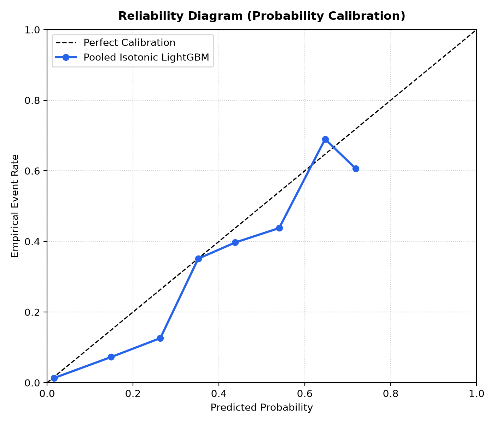

# NightWatch: A Sleep-Aware Digital Twin for Proactive Hypertension Risk Prediction

> **Disclaimer:** NightWatch is a research prototype for clinical **decision support**. It does not diagnose hypertension, replace validated BP measurement, or recommend treatment. All data is **synthetic**; no real patient data is used anywhere in this repository.

NightWatch fuses synthetic EHR records, simulated wearable context (sleep, HRV, resting HR, steps, medication adherence) and home BP-cuff readings into a per-patient **digital twin** that estimates the probability of a hypertensive episode in the next 24 hours (next-day SBP >= 140 or DBP >= 90). The home cuff is ground truth; wearables are context only (a watch never measures BP here). Outputs are *modeled estimates* "associated with" the inputs, never causal claims.

## Team
| Field | Details |
|---|---|
| Team name | Astra |
| College / incubator | Ramdeobaba University, Nagpur; incubator information not listed |
| Members |Niharika Pareek and Shraddha Sharma |
| Demo video |https://youtu.be/l-NqfRHf9oc |
| Presentation | [NightWatch_Presentation.pptx](docs/NightWatch_Presentation.pptx) |
| Architecture diagram | [NightWatch_Architecture.pdf](docs/NightWatch_Architecture.pdf) (source: [architecture.mmd](docs/architecture.mmd)) |

## Problem statement
Clinicians may need to review home blood-pressure measurements alongside a patient's recent sleep and wearable history when considering near-term hypertension risk. NightWatch explores this workflow with a synthetic digital twin; its estimates recover patterns from the simulator and are not evidence of real-world clinical performance.

## Healthcare use case
A clinician reviews a modeled next-24-hour hypertension episode estimate together with home cuff readings and wearable context, then decides whether to review the cuff log or document follow-up. The home cuff is the ground truth; wearable devices do not measure blood pressure in this project.

## Technical stack
- **Backend:** Python, FastAPI, SQLAlchemy, SQLite, REST and WebSocket APIs.
- **Modeling:** pandas, NumPy, scikit-learn, LightGBM, isotonic calibration, SHAP, and SciPy.
- **Dashboard:** React 19, TypeScript, Vite, Tailwind CSS 4, and ECharts.
- **Packaging:** Docker Compose.

## Quick start (Docker)
```bash
docker compose up --build
```
Dashboard: http://localhost:8080 | API docs: http://localhost:8000/docs
First start seeds 200 synthetic patients (about 1-2 min). Sign in with `dr_clinician` / `nightwatch2026` (demo account on synthetic data).
Then start the live sensor simulator (or use the Simulator button in the dashboard):
```bash
python scripts/simulator.py start --step 10
```

## Local development (Windows PowerShell)
```powershell
py -3.11 -m venv .venv; .\.venv\Scripts\Activate.ps1
pip install -r backend/requirements.txt
Copy-Item .env.example .env
uvicorn backend.app.main:app --port 8000          # terminal 1
cd dashboard; npm install; npm run dev            # terminal 2 (Vite prints the URL, default :5173)
```

## Features
- **24h Risk Horizon:** measured history vs modeled forecast, visually distinct; data-table alternative for every chart.
- **Live twin:** WebSocket updates with 5 s polling fallback; simulator streams wearable + cuff data.
- **What-If simulator:** counterfactual sleep / adherence / activity changes with a ghosted trajectory.
- **Sleep Fingerprint:** six-axis deviation from the patient's personal baseline.
- **Why risk changed:** SHAP factor attribution. **Persistent alert feed:** acknowledge / snooze / false-positive, with cooldown de-duplication.
- **Safety behaviour:** predictions are refused when sensor coverage < 50%; JWT + role-based access; times stored in UTC, shown in Asia/Kolkata.

## AI/ML model and evaluation
LightGBM + isotonic calibration, patient-grouped 5-fold CV (200 synthetic patients), TreeSHAP explanations. Code: `ml/` (`train_lightgbm.py`, `evaluate.py`, `robustness.py`, `explain.py`); full report in `docs/evaluation_report.md`, `docs/model_card.md`.

<!-- METRICS:START -->
| Metric | Value |
|---|---:|
| Pooled out-of-fold ROC-AUC (patient-cluster 95% CI) | 0.7751 (0.7338 to 0.8155) |
| 5-fold mean ROC-AUC +/- SD (separate quantity) | 0.8143 +/- 0.0283 |
| Pooled out-of-fold PR-AUC | 0.5194 |

| Operating point | Threshold | Sensitivity | Specificity | Precision | False alerts / patient-week | TP | FP | TN | FN |
|---|---:|---:|---:|---:|---:|---:|---:|---:|---:|
| Moderate | 0.34 | 69.9% | 70.4% | 42.5% | 1.580 | 525 | 711 | 1688 | 226 |
| High | 0.47 | 36.8% | 91.7% | 58.0% | 0.444 | 276 | 200 | 2199 | 475 |

| Paired ablation | Fold-mean ROC-AUC difference +/- SD | Fold wins |
|---|---:|---:|
| Tier 2 (EHR+BP) vs Tier 1 (EHR) | +0.1671 +/- 0.0405 | 5/5 |
| Tier 3 (+Sleep/HRV) vs Tier 2 (EHR+BP) | +0.0035 +/- 0.0093 | 3/5 |
| Tier 4 (Full Twin) vs Tier 3 (+Sleep/HRV) | -0.0016 +/- 0.0039 | 2/5 |

| BP availability | Fold-mean paired dAUC +/- SD (n=5) | Fold wins | Pooled OOF paired dAUC | Pooled bootstrap mean and patient-cluster 95% CI | Fold t-test p | Conclusion |
|---|---:|---:|---:|---:|---:|---|
| Daily | +0.0035 +/- 0.0093 | 3/5 | +0.0040 | +0.0042 [-0.0093, +0.0166] | 0.4891 | not supported |
| 2–3 readings/week | +0.0186 +/- 0.0222 | 4/5 | +0.0360 | +0.0364 [+0.0165, +0.0579] | 0.1689 | suggestive (CI excludes 0 but fold evidence weak) |
| 1 reading/week | +0.0474 +/- 0.0386 | 4/5 | +0.0620 | +0.0619 [+0.0292, +0.0960] | 0.0702 | supported |

BP history is the consistent gain; sleep/HRV help only when cuff readings are sparse (see table), and not at all in the daily setting.

Calibration figure: 
<!-- METRICS:END -->

Reproduce in Windows PowerShell with .\scripts\evaluate.ps1 or .\.venv_check\Scripts\python.exe -m ml.robustness. GNU make is optional.

## Repository layout
`backend/` FastAPI app, services, simulators, tests | `ml/` training, evaluation, explainability, artifacts | `dashboard/` React 19 + Vite + TypeScript + Tailwind 4 + ECharts | `docs/` model card, data dictionary, design spec, architecture | `scripts/` dev + simulator scripts.

## Tests
```powershell
$env:JWT_SECRET_KEY="test"; pytest backend/tests -q
```

## Data statement
All patients, EHR fields, wearable streams and BP readings are generated by `backend/app/simulation/` from fixed seeds. No real data, credentials or PHI are included. Demo credentials are for the synthetic demo only.

## Limitations
Labels are derived from simulated next-day cuff readings, which in turn are generated from a hidden latent risk score that includes sleep debt, HRV drop, activity and stress terms, so model results measure recovery of the simulator's assumptions and are not evidence on real patients.

CGM not included: the target is hypertension, the guidelines list CGM as an example; sleep stages, HRV, steps, resting HR and medication timing are included. Genetic markers are out of scope for this run.

## AI-assisted development disclosure
AI assistants were used for coding. Human team members are responsible for reviewing the implementation and confirming that the submission meets competition rules.

## License
[MIT License](LICENSE).

